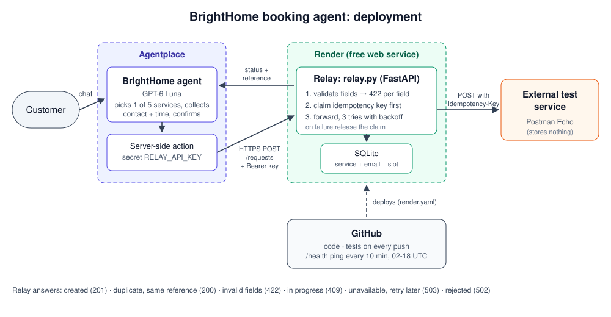

# BrightHome booking agent: Agentplace FDE test task

An Agentplace agent (free GPT-6 Luna model) for a home-services company. A customer picks one of five
services and leaves a request with contact details and a preferred time. The agent hands each request to a
small relay service, which checks the fields and passes the request to an external test service exactly once.

- **Agent:** https://rmilrbpxocb3.run.agentplace.io/
- **Relay:** https://booking-relay.onrender.com (health check: `/health`)
- **External test service:** [Postman Echo](https://postman-echo.com), which answers like a real API and stores nothing

## How it fits together



1. The agent collects service, name, email, optional phone, preferred time and optional notes, then confirms
   them with the customer.
2. It calls `POST /requests` on the relay from Agentplace's server side. The key never reaches the browser.
3. The relay validates the fields. If any are wrong, it returns them by name so the agent can ask again, and
   nothing is sent.
4. It builds an idempotency key from service + email + time slot (or uses an `Idempotency-Key` header if the
   caller sends one) and claims it in SQLite **before** calling out, so two identical submissions in flight
   can't both go through.
5. It posts to the external service with the same key, retrying network errors and 5xx answers three times
   (0.5 s, then 1 s). On failure it releases the claim, so the customer can try again later without being
   told it's a duplicate.

## API

`POST /requests` with `Authorization: Bearer <RELAY_API_KEY>` (only when the key is set) and a JSON body:

```json
{
  "service": "plumbing",
  "name": "Test Customer",
  "email": "test@example.com",
  "phone": "+1 555 010 0000",
  "preferred_time": "2026-12-01T15:00:00+05:30",
  "notes": "Kitchen sink leaking"
}
```

`service` is one of `cleaning`, `plumbing`, `electrical`, `ac_service`, `pest_control` (`GET /services`).
`phone` and `notes` are optional. `preferred_time` is ISO 8601 with a timezone offset, in the future.

| HTTP | `status` | Meaning | What the agent tells the customer |
|---|---|---|---|
| 201 | `created` | Sent once; `reference` returned | Confirms with the reference |
| 200 | `duplicate` | Already submitted; same `reference`, nothing new sent | It's already in, gives the reference |
| 422 | `invalid` | `errors: [{field, message}]`, nothing sent | Asks again for those fields |
| 409 | `in_progress` | The same request is being sent right now | Waits; doesn't resend |
| 503 | `unavailable` | External service down after 3 tries; nothing created | Try again in a few minutes |
| 502 | `rejected` | External service refused the request; not retried | Apologises, offers another way to reach the company |
| 401 | `unauthorized` | Wrong or missing key | (configuration error) |

`GET /requests/{reference}` returns the status, service and time of a request, without contact details.

## Run it locally

```bash
python -m venv .venv
.venv/bin/pip install -r requirements.txt        # Windows: .venv\Scripts\pip
.venv/bin/uvicorn relay:app --reload
curl -X POST localhost:8000/requests -H "Content-Type: application/json" \
  -d '{"service":"cleaning","name":"Test Customer","email":"test@example.com","preferred_time":"2030-01-01T10:00:00+00:00"}'
```

Run the same curl twice to see `duplicate`. To see `unavailable`, start the relay with
`EXTERNAL_URL=http://localhost:9 uvicorn relay:app` (nothing listens there).

| Setting | Default | |
|---|---|---|
| `EXTERNAL_URL` | `https://postman-echo.com/post` | Where requests are handed off |
| `RELAY_API_KEY` | empty (no auth) | Bearer key the agent must send |
| `DB_PATH` | `relay.db` | SQLite file for idempotency keys |

## Tests

```bash
.venv/bin/pytest -q
```

The external service is replaced by a fake that records every call, so each test also checks how many
requests actually went out:

- **Successful submission:** 201, one call out, `Idempotency-Key` header forwarded.
- **Incomplete data:** 422 naming every bad field (unknown service, short name, no email, unparseable time); also past times and times without a timezone. Nothing sent.
- **Repeated submission:** the second call (name and email case retyped) returns `duplicate` with the same reference; one call out. Same with an explicit `Idempotency-Key`.
- **Unavailable service:** a 503 and a refused connection each get three tries, then `unavailable`, and leave nothing behind; when the service is back, the same request goes through once.
- Also: recovery on the second try, a 4xx from the service not retried, and the API key check.

### Checked live through the agent (21 Nov 2026)

| Case | What happened |
|---|---|
| Successful submission | Customer confirmed; relay answered 201 and the agent showed the reference |
| Incomplete data | `test@example` as the email: the agent asked for a complete address before sending anything |
| Repeated submission | Same details sent twice: 201, then 200 `duplicate` with the same reference |
| Unavailable service | `EXTERNAL_URL` pointed at a closed port: the agent said nothing was created and to try later ([screenshot](docs/live-unavailable.png)); after restoring it, the same request went through once |

The agent checks obvious gaps itself, and the relay checks again, because the relay can't trust its caller.

Fixed after a usability test: the review card now has **Submit request** and **Change details** buttons (typing
"please submit" still works), a "Sending your request, this can take up to a minute" state covers the relay
waking from sleep, and the welcome screen is static so the chat box is ready the moment the page loads.

## Deploy (Render, free)

1. Fork or push this repo to GitHub.
2. In Render: **New > Blueprint**, pick the repo. `render.yaml` creates the web service and generates
   `RELAY_API_KEY`.
3. Copy `RELAY_API_KEY` from the service's Environment tab into the Agentplace agent's server-side secret.
4. Keep it awake. Render's free plan sleeps after 15 idle minutes and takes about a minute to wake. A free
   cron-job.org job hits `/health` every 10 minutes, round the clock, which uses about 744 of the 750
   free hours in a month. Requests from cron-job.org keep a running service awake but don't wake a sleeping
   one: Render answers them with an instant 503. So if the relay ever does fall asleep, something else has
   to wake it. `keep-warm.yml` sends the same ping from GitHub Actions (set the Actions variable
   `RELAY_URL` to the Render URL), but GitHub runs scheduled workflows late or not at all, so treat it as a
   backup.

## Limits I'd change for production

- SQLite lives on Render's disk and is wiped on redeploy, so a duplicate sent across a redeploy would go
  through. Use Postgres or Redis (`SET NX`) for the claim.
- Postman Echo stores nothing. A real CRM or calendar would get the same `Idempotency-Key`, and ideally
  enforce it on its side too.
- One shared key between agent and relay. For several customers: a key per agent, plus rate limiting.
